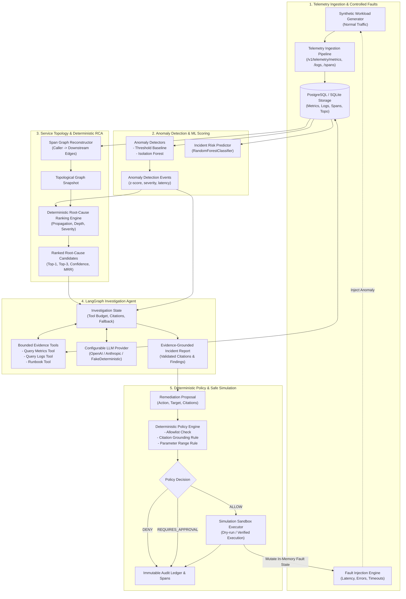

# AegisOps — System Architecture Overview

## 1. System Mission & Philosophy

AegisOps is an AI-assisted Site Reliability Engineering (SRE) platform engineered to automate incident triage, root-cause localization, and remediation simulation without compromising operational safety.

Traditional LLM-based autonomous agents pose severe availability risks when granted unbounded execution privileges or when allowed to diagnose issues without strict evidentiary grounding. AegisOps eliminates hallucination and unconstrained mutation through four architectural pillars:

1. **Deterministic Root-Cause Analysis (Phase 4)**: Causal localization uses topological dependency traversal and anomaly propagation scoring—never unconstrained LLM conjecture.
2. **Evidentiary Grounding & Bounded Agent Tools (Phase 5)**: The LangGraph investigation agent operates under strict tool call budgets ($N \le 5$), schema-enforced JSON citations, and verifiable telemetry links.
3. **External Deterministic Safety Policy (Phase 5 & 7)**: Remediation evaluation is performed strictly in deterministic Python code using an immutable allowlist and parameter bounds. An LLM cannot approve its own action or bypass safety boundaries via natural language explanation.
4. **Sandboxed In-Memory Simulation**: All remediation executions mutate only the in-process `FaultInjectionEngine` state. Zero live infrastructure modifications are permitted.

---

## 2. End-to-End Architectural Data Flow

The following Mermaid diagram maps the end-to-end data pipeline from telemetry ingestion through root-cause ranking, agent investigation, policy gating, and safe simulation.

---

## 3. Subsystem Breakdown

### 3.1 Telemetry Ingestion & Controlled Faults (`app.ingestion`)
- **Telemetry Batch Ingestion**: High-throughput ingestion of metric points, structured logs, and OpenTelemetry spans with schema bounds (RFC 7807 problem details on error).
- **Controlled Fault Injection (`FaultInjectionEngine`)**: Supports 3 deterministic synthetic fault profiles:
  - `latency_spike`: Injected service delay ($> 300\text{ms}$).
  - `error_surge`: Injected HTTP 500 error cascade ($> 20\%$).
  - `service_timeout`: Upstream timeout simulation ($> 1500\text{ms}$).
- **Safety Boundaries**: Targets restricted strictly to `SAFETY_ALLOWLISTED_SERVICES` (`["payment-service", "order-service", "inventory-service", "notification-service"]`). Duration strictly bounded between 5 and 300 seconds.

### 3.2 Machine Learning & Incident Risk (`app.ml`)
- **Baseline Threshold Detector**: Rolling window moving-average with statistical $z$-score evaluation ($z \ge 3.0$ triggers anomaly).
- **Isolation Forest Detector**: Unsupervised multivariate anomaly detector for high-dimensional metric feature spaces.
- **Incident Risk Predictor**: Supervised `RandomForestClassifier` trained on non-leaking chronological holdouts with temporal embargo guards.
- **Continuous Evaluation Harness (`scripts/evaluate_continuous.py`)**: Computes precision, recall, F1, false positive rates, and detects distribution drift over time.

### 3.3 Topology Reconstruction & Deterministic RCA (`app.topology`, `app.rca`)
- **Distributed Trace Graph**: Reconstructs caller $\to$ downstream dependencies from parent-child span relationships with cycle handling and depth bounding.
- **Deterministic Root-Cause Engine**:
  - Scores candidate services based on earliest anomaly onset, topological upstream centrality, and downstream propagation count.
  - Generates reproducible, explainable ranking (`Top-1`, `Top-3`, and MRR) without stochastic LLM behavior.
  - Abstains safely if telemetry is conflicting or candidate support is insufficient.

### 3.4 LangGraph Investigation Agent (`app.agent`)
- **State Machine Graph**: Built on LangGraph, coordinating node transitions:
  1. `assess_evidence_sufficiency`: Evaluates metric/log clarity, flags contradictions, and triggers abstention if ungrounded.
  2. `gather_evidence`: Calls targeted telemetry tools under strict iteration and budget limits ($\le 5$ tool calls).
  3. `synthesize_findings`: Combines telemetry citations with runbook steps.
  4. `generate_remediation_proposal`: Produces structured JSON proposals requiring citation backing.
- **Provider Resilience**: Gracefully falls back to local deterministic rule-based reasoning (`FakeDeterministicProvider`) if external LLM providers timeout or are offline.

### 3.5 Governance, Policy & Simulation (`app.agent.remediation`)
- **Remediation Policy Engine (`RemediationPolicyEngine`)**:
  - Hard constraint 1: Target must be in `SAFETY_ALLOWLISTED_SERVICES`.
  - Hard constraint 2: Action must belong to `RemediationActionType` enum.
  - Hard constraint 3: Numerical parameters bounded (e.g., latency $\in [0, 2000]\text{ms}$).
  - Hard constraint 4: Must cite $\ge 1$ verified evidence record.
  - Hard constraint 5: Operator approval gate for high-impact actions.
- **Sandboxed Simulation (`RemediationSimulationExecutor`)**:
  - Zero live production access.
  - Mutates only active in-memory experiment state in `FaultInjectionEngine`.
  - Verifies post-execution state (asserts fault cleared or mitigated).

### 3.6 Observability & Platform Manifest (`app.observability`, `app.core`)
- **Unified Pipeline Tracer (`PipelineTracer`)**: In-process span tracer tracking lifecycle duration, parent-child context, and error boundaries. Automatically masks credentials (`api_key`, `secret`, `password`, `authorization`, `prompt`).
- **Prometheus Metrics Registry (`MetricsRegistry`)**: Collects request counts, latencies, rca ranking accuracy, and policy denials with bounded label cardinalities.
- **Platform Manifest (`PlatformManifest`)**: Version-controlled cryptographic fingerprint recording model SHA-256 hashes, detector thresholds, and workflow git revisions.

---

## 4. Engineering Trade-offs

| Design Decision | Chosen Approach | Alternative Considered | Rationale & Trade-off |
| :--- | :--- | :--- | :--- |
| **Root-Cause Analysis** | Deterministic topological graph propagation | LLM-driven free-text reasoning | Eliminates stochastic hallucinations and non-reproducible incident diagnoses; trades flexible language nuance for auditability and 100% reproducibility. |
| **Policy Enforcement** | Hardcoded Python rules outside LLM context | LLM system-prompt guardrails | Natural language guardrails can be bypassed via prompt injection; deterministic code cannot be bypassed regardless of prompt contents. |
| **Remediation Action** | In-process simulation against `FaultEngine` | Real Kubernetes / Cloud API calls | Eliminates risk of destructive outage during testing; trades real infrastructure remediation for complete safety isolation. |
| **Benchmark Testing** | Controlled synthetic fixtures + local simulation | Cloud staging environment | Ensures test suite executes in $< 1\text{s}$ offline with zero external cloud dependencies or credentials. |
