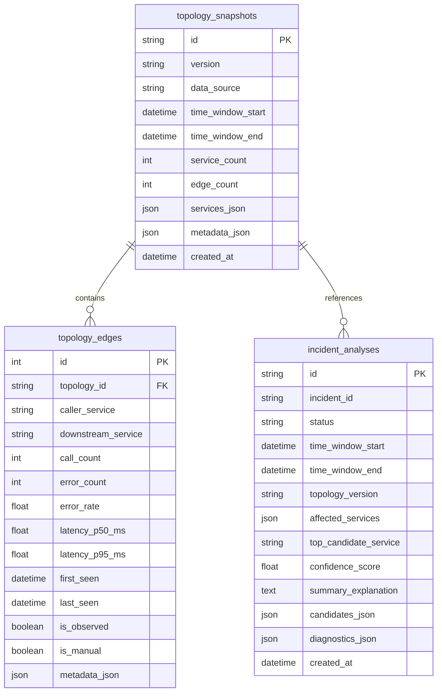

# AegisOps — Phase 4 Implementation Plan: Service Topology, Incident Correlation & Root-Cause Ranking

**Author:** AIOps Platform Architecture & ML Engineering  
**Date:** October 10, 2026  
**Status:** DRAFT / IN PROGRESS  
**Target Milestone:** Phase 4 Delivery  

---

## 1. Executive Summary & Objectives

Phase 1 established the core FastAPI backend, logging, configuration, and PostgreSQL database session management.  
Phase 2 implemented telemetry ingestion (metrics, logs, traces), service registry, and controlled fault injection experiments.  
Phase 3 delivered unsupervised anomaly detection (Isolation Forest), statistical baselines (Threshold, Rolling MAD), incident risk prediction, and a leak-free evaluation protocol.

**Phase 4 Objective:**  
Construct an integrated, explainable, and production-oriented **Root-Cause Analysis (RCA) subsystem** that discovers service topology from observed distributed traces, correlates multi-service operational anomalies across time windows, and ranks the most likely initiating "patient zero" services behind cascading operational outages.

### Core Non-Goals for Phase 4
- **No Phase 5 Agentic Investigation:** Do not implement LangGraph agents, multi-agent debates, or LLM-driven remediation workflows.
- **No Unsupervised/Black-Box Causal Claims:** Do not claim unverified causal certainty or train uncalibrated deep causal models. All ranking must be transparent, deterministic, and explainable.
- **No Breaking Changes:** Preserve all Phase 1, Phase 2, and Phase 3 API contracts, models, and tests.

---

## 2. Service Dependency Topology Architecture

### 2.1 Graph Edge Convention
We adopt the standard distributed systems directed invocation convention:
$$\text{caller\_service} \longrightarrow \text{downstream\_service}$$

**Example:**
When `order-service` receives an HTTP checkout request and invokes `payment-service` via HTTP client:
$$\text{order-service} \longrightarrow \text{payment-service}$$
And when `payment-service` queries `payment-db`:
$$\text{payment-service} \longrightarrow \text{payment-db}$$

### 2.2 Parent-Child Span Reconstruction
Cross-service calls are reconstructed strictly from parent-child relationships within distributed traces (`TraceSpanModel` / `SpanRecordSchema`):
1. **Trace Grouping:** Spans are partitioned by `trace_id`.
2. **Parent Resolution:** For each span $S_{\text{child}}$ where `parent_span_id` is present, find the corresponding $S_{\text{parent}}$ with `span_id == S_child.parent_span_id` within the same trace.
3. **Cross-Service Edge Detection:**
   - If $S_{\text{parent}}.\text{service\_name} \neq S_{\text{child}}.\text{service\_name}$:
     A directed cross-service dependency edge exists:
     $$S_{\text{parent}}.\text{service\_name} \longrightarrow S_{\text{child}}.\text{service\_name}$$
   - If $S_{\text{parent}}.\text{service\_name} == S_{\text{child}}.\text{service\_name}$:
     Classified as an internal service span (not a cross-service dependency edge).
4. **Incomplete Traces & Malformed Spans:**
   - Missing parent span in window: Recorded as unresolved; no synthetic edge is fabricated.
   - Self-cycles (`span_id == parent_span_id`), empty trace IDs, or missing service names are rejected, counted, and recorded in snapshot diagnostics.
5. **Edge Aggregation & Statistics:**
   Repeated invocations across traces are aggregated into edge metadata:
   - `call_count`: Total observed invocations.
   - `error_count`: Calls where child span status is `ERROR`.
   - `error_rate`: $\frac{\text{error\_count}}{\text{call\_count}}$.
   - `latency_p50_ms`, `latency_p95_ms`, `latency_mean_ms`.
   - `first_seen`, `last_seen`.
   - `is_observed`: `True` (differentiated from manually registered topology).

### 2.3 Graph Traversal & Cycle Handling
Real microservices topologies may exhibit mutual recursion or circular dependencies (e.g. callbacks).  
All graph algorithms (downstream reachability, upstream caller tracing, shortest paths) strictly use:
- Visited node sets.
- Configurable maximum depth bounds ($\text{max\_depth} \le 5$).
- Deterministic lexicographical sorting for tie-breaks.

---

## 3. Database Schema & Migration Design

We introduce an additive Alembic migration (`004_topology_and_root_cause.py`) creating three tables without modifying existing Phase 1–3 tables:

---

## 4. Anomaly Correlation Engine

Cascading operational failures typically start at a single service (e.g., connection pool exhaustion in `payment-service`) and propagate upstream to client services (e.g., HTTP 504 gateway timeout in `order-service`).

The correlation engine:
1. **Temporal Clustering:** Aggregates anomaly detection events (`AnomalyDetectionModel` or real-time detector outputs) within a sliding temporal correlation window ($\Delta t \le 180\text{s}$).
2. **Topological Cohesion:** Checks whether anomalous services belong to connected components in the active service topology or share trace IDs during the window.
3. **Cluster Filtering:** Unrelated anomalies occurring on completely disconnected services without shared traces or causal pathways are segregated into separate incident clusters.

---

## 5. Deterministic Root-Cause Ranking Formula

To ensure complete transparency and reproducibility, candidate initiating services are ranked using a deterministic composite score:

$$S_{\text{total}}(c) = w_{\text{origin}} \cdot S_{\text{origin}}(c) + w_{\text{temp}} \cdot S_{\text{temp}}(c) + w_{\text{impact}} \cdot S_{\text{impact}}(c) + w_{\text{sev}} \cdot S_{\text{sev}}(c)$$

Where weights sum to $1.0$:
- $w_{\text{origin}} = 0.35$: **Innermost/Deepest Trace Error Origin**  
  Measures whether candidate $c$ hosts the innermost child span that failed without a failing downstream callee.
- $w_{\text{temp}} = 0.30$: **Temporal Precedence**  
  Measures relative anomaly onset:
  $$S_{\text{temp}}(c) = \max\left(0.0, 1.0 - \frac{t_{\text{onset}}(c) - t_{\text{earliest}}}{\Delta t_{\text{window}}}\right)$$
- $w_{\text{impact}} = 0.20$: **Topological Reachability & Downstream Impact**  
  Measures the fraction of affected symptom services topologically reachable from $c$ (or calling $c$).
- $w_{\text{sev}} = 0.15$: **Anomaly Severity**  
  Normalized anomaly score and error rate deviation during the window.

### Stable Tie-Breaking
1. Earlier anomaly onset timestamp ($t_{\text{onset}}$).
2. Higher raw anomaly score.
3. Lexicographical service name order.

### Insufficient Evidence / Abstention Rule
If maximum candidate score $< 0.20$ or no anomalies/spans exist in the window:
- Return status `INSUFFICIENT_EVIDENCE`.
- Top candidate is `None`.
- Document explicit abstention reasons.

### Ground-Truth Isolation
Ground-truth fields (`initiating_service`, `target_service`, `experiment_id`, `fault_type`) are **strictly prohibited** from feature matrices, graph building, and ranking logic. They are accessed exclusively during the evaluation benchmark.

---

## 6. API Contracts

### Topology Endpoints (`/api/v1/topology`)
- `POST /api/v1/topology/rebuild`: Rebuilds topology snapshot from trace spans within bounded time window.
- `GET /api/v1/topology`: Retrieves current topology snapshot with service and edge summaries.
- `GET /api/v1/topology/services/{service_name}/dependencies`: Returns direct callers and downstream dependencies for a specific service.

### Root-Cause Analysis Endpoints (`/api/v1/incidents/root-cause`)
- `POST /api/v1/incidents/root-cause/analyze`: Executes root-cause analysis across a specified time window, correlates anomalies, ranks candidates, and persists the analysis record.
- `GET /api/v1/incidents/root-cause/{analysis_id}`: Retrieves a persisted analysis run with ranked candidates and evidence explanations.
- `GET /api/v1/incidents/root-cause`: Lists historical analysis runs with pagination.

---

## 7. Evaluation Protocol

We benchmark root-cause ranking against Phase 2 fault-injection ground truth (`ExperimentModel`):
- **Top-1 Accuracy:** Ground truth root cause ranked at position 1.
- **Top-3 Accuracy:** Ground truth root cause ranked within top 3 candidates.
- **Mean Reciprocal Rank (MRR):** $\frac{1}{N} \sum_{i=1}^N \frac{1}{\text{rank}_i}$.
- **Abstention Rate:** Proportion of ambiguous incidents where the system returned `INSUFFICIENT_EVIDENCE`.
- **Baseline Comparison:** Compare against naive **Earliest Anomaly** ranking baseline.
- **Evaluation Report:** Generated at `docs/PHASE_4_EVALUATION_REPORT.md` and saved to `ml/artifacts/root_cause_evaluation_report.json`.

---

## 8. Implementation Milestones

1. **Milestone 1:** Database models & Alembic migration `004_topology_and_root_cause.py`.
2. **Milestone 2:** Service topology extraction engine & graph representation (`app/topology/`).
3. **Milestone 3:** Anomaly correlation & deterministic root-cause ranking engine (`app/rca/`).
4. **Milestone 4:** FastAPI routers & schemas for topology and RCA.
5. **Milestone 5:** Evaluation benchmark runner script & report generation (`scripts/evaluate_root_cause.py`).
6. **Milestone 6:** Unit, integration, and regression testing suite; strict type checking and linting.
7. **Milestone 7:** Complete technical documentation updates.
