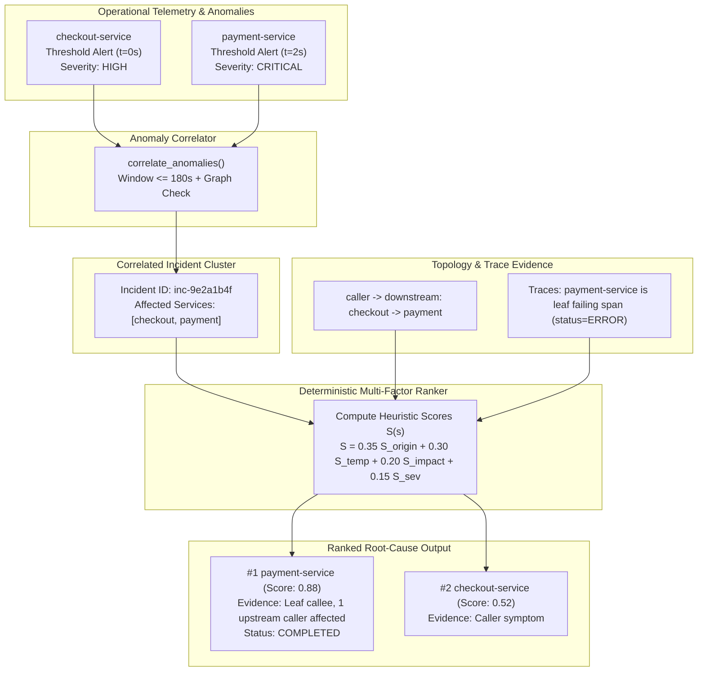

# AegisOps — Incident Anomaly Correlation & Deterministic Root-Cause Ranking

## 1. Architectural Overview

The **Root-Cause Analysis (RCA)** subsystem in AegisOps Phase 4 isolates and ranks initiating services behind cascading operational incidents.

When a microservice dependency fails (e.g., a database connection pool exhaustion in `payment-service`), multiple upstream callers (such as `checkout-service` and `frontend`) simultaneously experience elevated response latencies, HTTP 500 errors, and detector breaches. Naive monitoring systems often mistake the top-level caller for the root cause because client-facing alerts trigger immediately.

AegisOps solves this by synthesizing:
1. **Temporal Anomaly Clustering**: Sliding temporal windows group co-occurring detector signals.
2. **Topological Cascade Analysis**: Graph reachability maps symptoms to upstream/downstream dependencies.
3. **Distributed Trace Error Trees**: Distributed trace spans identify the innermost leaf failing callee in the RPC tree.



---

## 2. Temporal and Topological Anomaly Correlation

The `AnomalyCorrelator` clusters individual anomaly records from `AnomalyDetectionModel` into unified incidents:

1. **Temporal Clustering**: Consecutive anomalies occurring within `window_seconds` (default: 180s) form contiguous candidate clusters.
2. **Trace Linkage**: Events sharing a common `trace_id` are bound to the same cluster regardless of temporal offsets.
3. **Disjoint Topological Separation**: If multiple anomalies occur within the same time window but belong to completely disjoint sub-graphs in the service topology and share no trace IDs, they are partitioned into separate incidents to prevent merging unrelated operational events.
4. **Deterministic Identification**: Incident IDs are computed deterministically via SHA-256 hashes of the start timestamp and sorted affected service names (`inc-{hash[:12]}`).

---

## 3. Deterministic Root-Cause Ranking Formula

Every affected service $s \in \text{AffectedServices}$ receives a transparent score between $0.0$ and $1.0$:

$$S(s) = 0.35 \cdot S_{\text{origin}}(s) + 0.30 \cdot S_{\text{temp}}(s) + 0.20 \cdot S_{\text{impact}}(s) + 0.15 \cdot S_{\text{sev}}(s)$$

### 3.1 Trace & Call Origin ($S_{\text{origin}}$ — Weight: 0.35)
Identifies the innermost failing callee in the distributed call stack:
- **Leaf Error Callee**: $1.00$ (A span in service $s$ returned `ERROR`, and no child spans within that trace failed).
- **Deepest Dependency**: $0.90$ (Has affected upstream callers in topology, but no failing downstream dependencies).
- **Intermediate Cascade Node**: $0.65$ (Both affected callers and affected downstream dependencies).
- **Top-Level Entry Caller**: $0.40$ (No affected callers, but has failing downstream dependencies).
- **Isolated / Unmapped Node**: $0.50$.

### 3.2 Temporal Precedence ($S_{\text{temp}}$ — Weight: 0.30)
Evaluates arrival order relative to earliest anomaly onset:
$$S_{\text{temp}}(s) = \max\left(0.0, 1.0 - \frac{t_{\text{onset}}(s) - t_{\min}}{\Delta t_{\max} + 1.0}\right)$$
- The service with earliest onset $t_{\min}$ receives $S_{\text{temp}} = 1.0$.
- Later symptom cascades decay toward $0.0$ proportional to delay.

### 3.3 Topological Cascade Breadth ($S_{\text{impact}}$ — Weight: 0.20)
Measures the proportion of the affected cluster connected to candidate $s$:
$$S_{\text{impact}}(s) = \frac{|\text{ConnectedAffected}(s)|}{\max(1, |\text{AffectedServices}| - 1)}$$
Where $\text{ConnectedAffected}(s) = (\text{UpstreamCallers}(s) \cup \text{DownstreamDependencies}(s)) \cap \text{AffectedServices} \setminus \{s\}$.

### 3.4 Anomaly Confidence and Severity ($S_{\text{sev}}$ — Weight: 0.15)
$$S_{\text{sev}}(s) = 0.5 \cdot \overline{\text{score}}(s) + 0.5 \cdot w_{\text{sev}}(s)$$
Where severity weights are: `CRITICAL` ($1.0$), `HIGH` ($0.8$), `MEDIUM` ($0.5$), `LOW` ($0.3$), `INFO` ($0.1$).

---

## 4. Deterministic Tie-Breaking & Abstention

### 4.1 Stable Tie-Breaking Order
When multiple candidates receive identical scores:
1. **Primary**: Total Heuristic Score descending ($S$).
2. **Secondary**: Earliest Anomaly Onset ascending ($t_{\text{onset}}$).
3. **Tertiary**: Mean Anomaly Score descending ($\overline{\text{score}}$).
4. **Quaternary**: Service Name lexicographically ascending (`service_name`).

### 4.2 Abstention & Insufficient Evidence
AegisOps avoids speculative guessing:
- If no operational anomalies exist in the window: `status = "INSUFFICIENT_EVIDENCE"`.
- If top candidate score $< 0.20$: `status = "INSUFFICIENT_EVIDENCE"`, `top_candidate_service = None`, `confidence_score = None`.

---

## 5. Machine-Readable Evidence & Explanations

Each ranked candidate includes a `CandidateEvidence` object:
- `candidate_service`: Service identifier.
- `anomaly_onset`: Timestamp of first signal.
- `relative_delay_sec`: Delay relative to earliest incident signal.
- `is_innermost_callee`: Whether spans prove leaf error execution.
- `failing_span_count`: Number of observed failing spans.
- `downstream_symptoms`: Downstream affected services.
- `upstream_callers`: Upstream affected services invoking candidate.
- `positive_indicators`: Specific facts supporting the candidate.
- `contradictory_indicators`: Counter-evidence or latency lag.
- `uncertainty_reasons`: Missing trace telemetry or topology gaps.
- `explanation`: Deterministic, non-hallucinated evidence summary string.

---

## 6. Strict Ground-Truth Isolation

To maintain scientific and operational integrity:
- Ground-truth labels from `ExperimentModel` (`initiating_service`, `target_service`, `scenario_name`) are strictly segregated from inference inputs.
- RCA endpoints operate solely on observed telemetry (`anomaly_detections`, `trace_spans`, `topology_snapshots`).
- Ground-truth data is reserved exclusively for the offline evaluation benchmark (`scripts/evaluate_root_cause.py`).

---

## 7. REST API Reference

### Trigger Root-Cause Analysis
- **Endpoint**: `POST /api/v1/incidents/root-cause/analyze`
- **Payload**:
  ```json
  {
    "lookback_minutes": 15,
    "correlation_window_seconds": 180.0,
    "topology_id": null,
    "persist": true
  }
  ```
- **Response**: `200 OK` with `RootCauseAnalysisResponse` containing ranked candidates and diagnostics.

### Retrieve Saved Analysis Run
- **Endpoint**: `GET /api/v1/incidents/root-cause/{analysis_id}`
- **Response**: `200 OK` with full persisted analysis record.

### List Analysis Runs
- **Endpoint**: `GET /api/v1/incidents/root-cause?limit=20&offset=0`
- **Response**: `200 OK` with paginated list of previous RCA executions.
