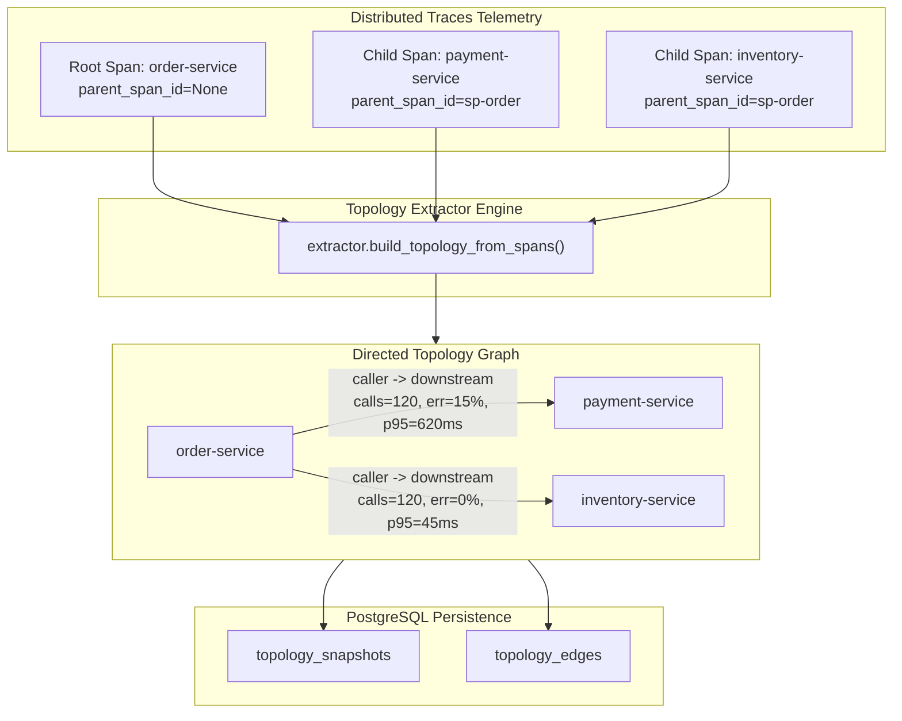

# AegisOps — Service Dependency Topology & Distributed Trace Reconstruction

## 1. Architectural Overview

The **Service Topology** subsystem in AegisOps Phase 4 reconstructs, versions, and queries directed service dependency graphs dynamically extracted from distributed trace spans (`trace_spans` table).

Unlike static architecture diagrams or manual configuration manifests, the runtime topology reflects observed production communication paths, call volumes, error cascades, and latency distributions across microservices.



---

## 2. Directed Edge Convention & Span Parsing Rules

### 2.1 Edge Direction
AegisOps strictly adheres to the convention:

$$\text{caller\_service} \longrightarrow \text{downstream\_service}$$

- **Caller (Parent)**: The upstream initiating service that makes the outbound RPC/HTTP request.
- **Downstream (Callee)**: The dependency invoked by the caller to execute an operation.
- Example: When `order-service` calls `payment-service`, the directed edge is `order-service -> payment-service`.

### 2.2 Parent-Child Span Relationship Reconstruction
1. Spans are grouped by `trace_id`.
2. For each span with a non-null `parent_span_id`, the parent span is looked up within the same trace.
3. If the parent span's `service_name` differs from the child span's `service_name`, a cross-service edge is observed.
4. **Intra-service Filtering**: When a child span represents an internal database query or function call within the same service (`parent.service_name == child.service_name`), it is recorded as internal execution and does not generate self-loop dependency edges.
5. **Orphan Spans**: Spans whose parent is not present in the observation window are safely cataloged as active service nodes in `diagnostics["unresolved_parents"]` without fabricating speculative edges.
6. **Malformed Spans**: Spans with missing identifiers or self-referential IDs (`span_id == parent_span_id`) are safely quarantined in `diagnostics["malformed_spans"]`.

---

## 3. Statistical Aggregations on Dependency Edges

Each directed edge aggregates metrics across repeated trace observations:
- `call_count`: Total observed cross-service invocations.
- `error_count`: Number of child spans where `status_code == 'ERROR'`.
- `error_rate`: Proportion of failing requests:
  $$\text{error\_rate} = \frac{\text{error\_count}}{\text{call\_count}}$$
- `latency_p50_ms`: Median duration in milliseconds.
- `latency_p95_ms`: 95th percentile duration in milliseconds.
- `first_seen` / `last_seen`: UTC timestamps of the first and most recent span observation.
- `is_observed`: `True` for dynamically discovered edges.
- `is_manual`: `True` for administratively defined dependencies.

---

## 4. Graph Algorithms & Cycle Safety

Microservice systems can exhibit circular or asynchronous call paths (e.g., event loops, webhooks). The Python `TopologyGraph` data structure guarantees safety:

1. **Cycle Detection (`has_cycle()`)**: Uses depth-first search recursion stack tracking to detect cycles in $O(V + E)$ time.
2. **Depth-Bounded Traversal**: Both `get_all_downstream()` and `get_all_upstream()` enforce a configurable `max_depth` (default: 5) and maintain `visited` sets to prevent infinite recursion.
3. **Path Finding (`find_paths()`, `find_path()`)**: Discovers directed acyclic paths between any source and destination service.
4. **Deterministic Serialization**: Graph snapshots sort nodes and edges lexicographically to ensure repeatable hashes and snapshots.

---

## 5. Persistence Model & Database Schema

Defined in [`backend/app/db/models/topology.py`](file:///c:/Users/admin/Desktop/AegisOps/backend/app/db/models/topology.py) and applied via migration `004_topology_and_root_cause`:

- `topology_snapshots`:
  - `id`: Unique snapshot string identifier (e.g. `topo-3f41a87b1c20`).
  - `version`: Semantic version string (e.g. `topo-v20261010.120000`).
  - `data_source`: Telemetry origin (e.g. `trace_spans`).
  - `time_window_start` / `time_window_end`: Bounded observation window.
  - `service_count` / `edge_count`: Summary statistics.
  - `services_json`: JSON list of unique service node names.
  - `metadata_json`: Cycle status, diagnostic metrics.
- `topology_edges`:
  - `topology_id`: Foreign key with cascading delete to `topology_snapshots.id`.
  - `caller_service`: Index on upstream caller.
  - `downstream_service`: Index on downstream callee.
  - Composite index `(topology_id, caller_service, downstream_service)`.

---

## 6. REST API Reference

### Rebuild Topology Snapshot
- **Endpoint**: `POST /api/v1/topology/rebuild`
- **Payload**:
  ```json
  {
    "lookback_minutes": 60,
    "version": "topo-prod-v1.2",
    "data_source": "trace_spans"
  }
  ```
- **Response**: `201 Created` with `TopologySnapshotResponse`.

### Query Active or Specific Topology
- **Endpoint**: `GET /api/v1/topology`
- **Query Params**: `identifier` (optional snapshot ID or version string; returns latest if omitted).
- **Response**: `200 OK` with full node list and dependency edges.

### List Topology Snapshots
- **Endpoint**: `GET /api/v1/topology/snapshots?limit=20&offset=0`
- **Response**: `200 OK` with paginated summary list.

### Query Service Direct Dependencies
- **Endpoint**: `GET /api/v1/topology/services/{service_name}/dependencies`
- **Query Params**: `topology_id` (optional).
- **Response**: `200 OK` returning `direct_callers` and `direct_downstream` lists with error rates and latencies.
